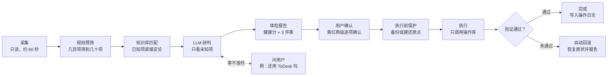
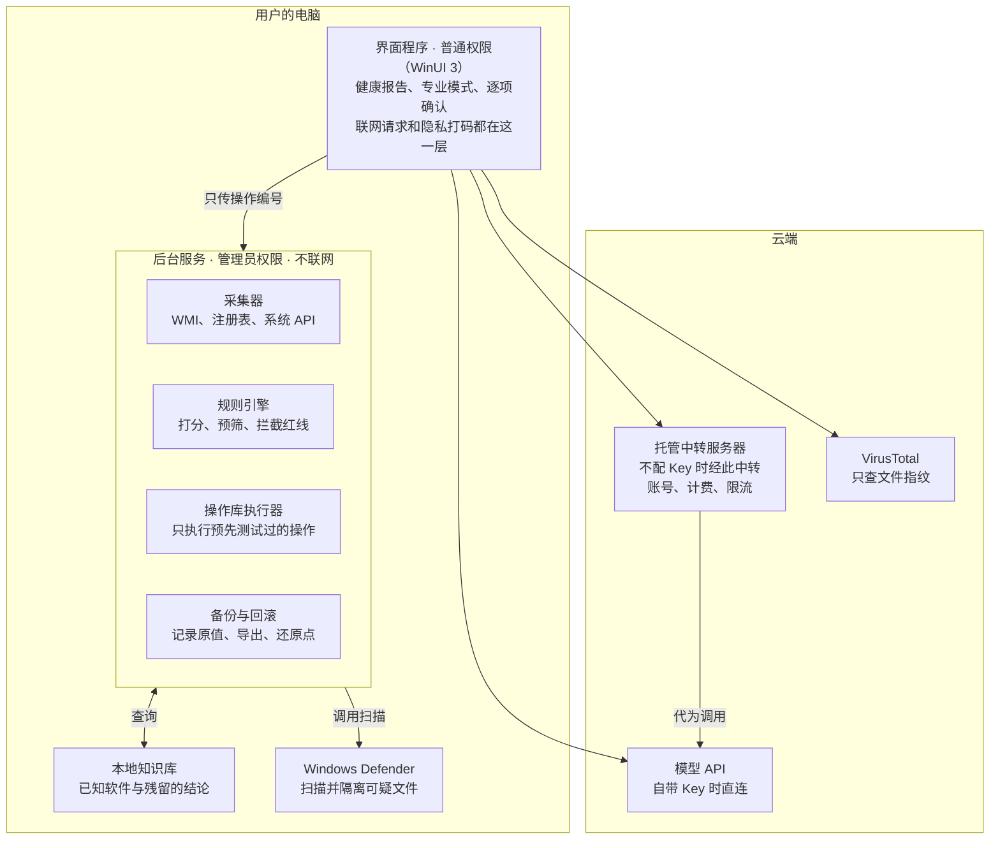
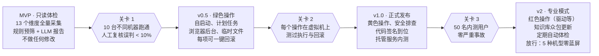

# AI 电脑体检 · 核心设计文档

2026-10-24 · Wilhelm

> 本文件导出自 Claude Docs 上的《AI 电脑体检 · 核心设计文档》，是项目的设计依据。图已改写为 Mermaid。

做一款面向中文 Windows 用户的 AI 电脑体检工具：固定代码采集信息，LLM 负责判断和解释，执行只能从预先测试过的操作库里选，每一步都可解释、可回滚。

## 1. 定位与设计原则

产品是"会解释的电脑医生"，不是又一个一键加速的清理工具，也不是杀毒软件。核心价值是把进程、服务、计划任务、驱动和已装软件交叉对照，判断"这是什么、该不该动、怎么动最安全"，再用人话讲清楚。

**做什么**

- 体检：性能、存储、启动、后台、驱动、安全设置、软件残留
- 判断：识别国产全家桶残留、流氓自启动、捆绑驱动、重复旧驱动
- 处理：只执行操作库里的操作，每一步先备份，可回滚
- 解释：每条结论都附带证据和原因

**不做什么**

- 不做杀毒引擎，查杀交给 Windows Defender
- 不让 LLM 生成命令直接执行
- 不做"内存加速球"、注册表清理这类伪优化
- 不默认上传任何文件内容

**六条铁律**

1. **只读优先**：先完整采集、给出报告，用户确认之后才改动任何东西
2. **LLM 只判断，不执行**：LLM 输出的是"对某个对象执行操作库中的某个操作"，不是 shell 命令
3. **每个改动都可回滚**：执行前建还原点或备份，执行后记录回滚方式
4. **结果要可验证**：执行后重新检测对象状态，确认真的生效，不能只打印"成功"
5. **正在运行的内核驱动不停止**：只标记删除，重启后生效（来自 2026-10-23 的蓝屏教训）
6. **证据先于结论**：报告里的每条判断都要能指回具体证据，比如路径、签名、注册表位置

## 2. 用户与模式

同一份报告、两种深度：小白只看结论，只能执行绿色操作；专业模式显示全部证据，黄色和红色操作只在这里出现。底层只维护一套体检逻辑。

| 层级 | 看到什么 | 能执行的操作 | 确认方式 |
| --- | --- | --- | --- |
| 默认视图 | 健康分（0–100）、最该处理的 3 件事、每件一句人话 | 仅绿色 | 一键处理，整批确认一次 |
| 展开详情 | 每条的"为什么这么判断"、处理后的预期效果 | 仅绿色 | 可逐项勾选 |
| 专业模式（开关） | 原始证据（路径、签名、注册表、服务名）、将执行的操作、回滚方式、完整日志 | 绿色 + 黄色 + 红色 | 黄色逐项确认；红色逐项确认 + 强制建还原点 |

**健康分的建议权重**（可调）：安全 30%、性能与后台 25%、存储 20%、启动 15%、驱动与系统设置 10%。扣分项必须能在详情里找到，不做"吓唬式"低分。

**措辞规则**：默认视图不出现服务名、驱动名、注册表路径，用"网银的键盘保护程序"代替 PECKbdProtector。

## 3. 体检维度全清单

共 13 个维度，全部用只读方式采集，一次完整体检目标在 60 秒内完成（不含 Defender 扫描）。"典型问题"一列来自中文用户的真实情况，也是规则库和测试用例的来源。

| 维度 | 采集什么 | 判断标准（触发即进入 LLM 研判） | 典型问题 |
| --- | --- | --- | --- |
| 资源占用 | CPU / 内存 / 磁盘 / GPU 实时与累计占用、内存压缩、正常运行时间 | 内存常驻 > 80%；空闲 CPU > 15%；Memory Compression 累计 CPU 排第一；运行 > 7 天未重启 | 内存不足导致系统反复压缩内存，开机即发热 |
| 进程 | 进程名、路径、数字签名、父进程、按程序汇总的内存 | 从 AppData / Temp 运行；无签名；伪装系统进程名；单个程序 > 500 MB | DeepL 内嵌浏览器、Edge 启动增强预加载 15 个进程 |
| 开机自启动 | Run / RunOnce 注册表、启动文件夹、设置里的启动应用、商店应用后台权限 | 非必要自启；指向已卸载软件 | 全家桶自启、壁纸软件常驻 |
| 服务 | 名称、路径、启动类型、状态、文件厂商 | 第三方自动启动；路径在用户目录；软件已卸载但服务还在 | 装软件时顺带开启了 IIS / FTP 服务器 |
| 计划任务 | 全部任务（含 \\Microsoft 目录）、触发器、运行的程序和参数、上次结果 | 指向不存在的文件；调用 powershell / mshta / vbs；程序在用户目录；每小时触发 | 360 划词搜索、火绒、爱奇艺的残留；WPS / Zoom 每小时检查更新 |
| 驱动 | 驱动仓库全量、内核驱动服务、设备过滤器列表、幽灵设备、内存完整性不兼容清单 | 同一驱动多个旧版本；无对应设备；反作弊 / 加速器残留；挂在键盘等设备上的第三方过滤器 | 蓝牙驱动 10 份副本、网银键盘保护、腾讯反作弊、旧上网卡驱动 |
| 已装软件 | 卸载注册表 + 商店应用：名称、大小、安装位置、安装日期 | 体积大且长期未用；同类功能重复；命中已知捆绑 / 流氓名单 | 三个音乐软件、两套办公软件、三个会议软件 |
| 存储 | 各盘可用空间、系统与保留（休眠、虚拟内存、还原点）、临时文件、大文件夹、空壳文件夹 | C 盘可用 < 15%；游戏库或大型软件在 C 盘；conda / pip 缓存 > 2 GB | 22 GB 的游戏装在 C 盘，而 Steam 本体在 D 盘 |
| 电源与电池 | 电源模式、快速启动、休眠、设计容量 / 满充容量、循环次数、充电功率 | 电池健康 < 80%；快速启动开启（关机不清内存）；插电时充电功率 < 10 W | 负载高导致充电只有 4 W |
| 安全设置 | Defender 状态与检测记录、内存完整性、内核堆栈保护、防火墙、UAC、BitLocker | 任一防护关闭或因不兼容驱动无法开启 | 旧驱动导致内存完整性打不开 |
| 浏览器与网络 | 浏览器后台运行、启动增强、扩展列表、系统代理、hosts、DNS | 代理或 hosts 被改；未知扩展；关闭窗口后仍在后台 | Chrome / Edge 关掉后仍占 1 GB |
| 驱动与系统版本 | 显卡等关键驱动的当前版本与仓库中最新版本、待安装更新 | 仓库有新版但未生效 | 华为 2021 年定制显卡驱动压住 Intel 新版 |
| 稳定性 | 蓝屏记录（事件日志 BugCheck、Minidump）、应用崩溃、可靠性记录 | 30 天内蓝屏 ≥ 1 次；同一驱动反复出现 | 蓝屏终止代码指向某个第三方驱动 |

采集源优先用 WMI / CIM、注册表和 Windows API，不解析命令行工具的文字输出：中文系统下 sc、pnputil 的输出会本地化，文字解析容易出错。

## 4. 安全排查模块

不做杀毒引擎，只做"可疑项排查"：由 Defender 负责扫描和隔离，规则从几百个对象里筛出十几到几十个可疑项，LLM 只研判这一小部分并解释。对外不称"杀毒"，称"安全体检"。

**不自己做杀毒的三个理由**

- LLM 读不了二进制文件，判断不了一个 exe 是不是病毒
- 全盘几十万到上百万个文件，交给 LLM 的成本和耗时都不现实
- 在 Windows 安全中心注册为杀毒软件需要加入微软 MVI 计划，个人开发者基本无法进入

**三层流程**

| 层 | 做什么 | 谁来做 | 耗时 |
| --- | --- | --- | --- |
| ① 现成引擎 | 读 Defender 状态与检测记录，按需发起快速扫描或脱机扫描 | Windows Defender | 几分钟 |
| ② 可疑行为规则 | 只查病毒常见的藏身处（见下表） | 固定代码 | 几秒到几十秒 |
| ③ 研判 | 只把命中规则的对象及上下文交给 LLM，判断是正常、残留、流氓还是可疑 | LLM | 一次请求 |

**可疑行为规则（第一版）**

| 规则 | 检查位置 | 分值 |
| --- | --- | --- |
| 可执行文件位于 AppData / Temp / ProgramData 根目录 | 进程、服务、自启动、计划任务 | 高 |
| 系统进程名（svchost、csrss、explorer 等）但不在 System32 | 进程 | 高 |
| 计划任务调用 powershell 编码命令、mshta、wscript、.vbs | 计划任务、WMI 事件订阅 | 高 |
| 无数字签名或签名无效 | 进程、服务、驱动 | 中 |
| 空闲时 CPU / GPU 长期高，或打开任务管理器后占用突降 | 性能计数器（分两次采样对比） | 高（挖矿特征） |
| 与矿池常用端口或域名的长连接 | 网络连接表 | 高 |
| hosts 或系统代理被改、DNS 被设为非常见地址 | 网络设置 | 中 |
| 浏览器扩展来自商店以外或权限过大 | 浏览器配置 | 中 |

**可疑文件的进一步核实**

- 计算 SHA-256，用户填自己的免费 Key 后去 VirusTotal 查询。**只上传指纹，不上传文件**
- 检查数字签名的签发者与证书链
- 以后可以接入开源 YARA 规则做本地匹配

**处置边界**：发现可疑文件一律交给 Defender 隔离，本软件不自行删除可疑文件，避免误删正常软件的责任。

## 5. 风险分级与操作库规范

所有改动只能来自操作库。每个操作预先定义好风险等级、前置检查、备份、验证和回滚，并在测试机上跑通后才能上线。

**三级风险**

| 等级 | 定义 | 操作举例 | 执行要求 |
| --- | --- | --- | --- |
| 绿 | 完全可逆，不影响任何功能 | 关闭自启动、禁用更新类计划任务、关闭浏览器后台、清理临时文件 | 记录原值；可整批一键执行 |
| 黄 | 可逆，但可能影响某个功能 | 第三方服务改手动、卸载软件、删除旧版重复驱动（不加 /force）、关闭快速启动 | 逐项确认；说明代价；先备份 |
| 红 | 难以逆转或可能导致系统不稳 | 强制删除驱动包、删除内核服务、移走系统目录下的驱动文件、更换显卡驱动、修改设备过滤器 | 仅专业模式；强制建还原点；导出备份；逐项确认 |

**每个操作必须包含的字段**

```json
{
  "id": "service.set_manual",
  "name": "把服务改为手动启动",
  "risk": "yellow",
  "target": { "type": "service", "name": "<服务名>" },
  "preconditions": ["服务存在", "不在系统关键服务名单中", "文件厂商不是 Microsoft"],
  "backup": "记录原启动类型和运行状态",
  "execute": "调用服务控制 API 修改启动类型",
  "verify": "重新读取启动类型，确认为 Manual",
  "rollback": "恢复原启动类型",
  "needsReboot": false,
  "knownRisks": "依赖它的软件首次使用时可能启动稍慢"
}
```

执行结果必须来自 `verify` 的重新检测，而不是执行步骤有没有报错。

**红线（操作库代码里硬编码拦截，LLM 无法绕过）**

1. 正在运行的内核驱动不停止，只标记删除，重启后再处理文件
2. 删除驱动或服务前，先从所有设备类的 UpperFilters / LowerFilters 中摘除它，否则键盘、磁盘等设备可能在重启后失灵
3. 不动微软签名的驱动和 Windows 自带驱动（AMD、LSI、Mellanox 等存储驱动虽非微软厂商，但属于系统自带）
4. 不动引导启动（Boot / System 启动类型）且正在运行的驱动，除非有专门的卸载程序
5. 删除旧版驱动不加 /force，让系统自动拒绝删除正在使用的版本
6. 不关闭 Defender、防火墙、UAC；不清空回收站；不永久删除用户文件
7. 系统拒绝写入的位置（如受保护的策略注册表）不硬改，改用官方入口或提示用户手动处理
8. 会改变用户习惯的操作（关闭休眠、禁用小组件）必须先说清代价，比如"关闭休眠后，笔记本合盖放包里会更耗电"
9. 用带 Policy 的方式修改浏览器设置时，提前告诉用户会出现"由你的组织管理"

## 6. LLM 分工、提示词与隐私

LLM 只在"规则判断不了"和"需要说人话"的地方出场，其余全部由固定代码完成。风险等级和红线由代码决定，LLM 的输出改不了它们。

**分工**

| 环节 | 固定代码 | LLM |
| --- | --- | --- |
| 采集 | 全部 | 不参与 |
| 预筛 | 规则打分，筛出待研判对象 | 不参与 |
| 识别对象 | 先查本地知识库（名称、厂商、指纹） | 知识库没有的：判断来源和用途 |
| 处置建议 | 决定风险等级、拦截红线、校验操作是否存在 | 从操作库中挑选操作并排序 |
| 解释与问答 | 报告模板 | 用人话解释、回答用户追问、拿不准时反问用户 |

**提示词结构**

1. 系统提示：角色、六条铁律、红线、输出格式
2. 机器概况：系统版本、CPU、内存、各盘空间、品牌机型
3. 证据清单：只含预筛命中的对象，每项带编号、类型、路径（已打码）、签名、启动方式、关联对象（比如"这个进程属于哪个已装软件"）
4. 可用操作：每类对象允许的操作编号
5. 输出格式：JSON，每项包含对象编号、结论（正常 / 残留 / 流氓 / 可疑 / 不确定）、置信度、引用的证据、建议操作编号、给用户的一句话解释

**输出校验**：操作编号不在操作库里就丢弃；置信度低或结论为"不确定"时，不自动处理，改为问用户（比如"你还用不用 ToDesk？"）。

**模型接入**：支持 OpenAI 兼容接口，覆盖 DeepSeek、通义、Kimi、智谱等国内模型和海外模型。优先使用模型自带的结构化输出（JSON 模式），并保留一个不联网的"纯规则模式"。

**隐私打码（发送前在本地完成）**

- 路径中的用户名：`C:\Users\Alice` → `C:\Users\<用户>`
- 计算机名、邮箱、IP / MAC 地址、Wi‑Fi 名称、各类序列号
- 文件内容一律不发送，只发文件名、大小、签名和指纹
- 专业模式提供"查看将要发送的内容"预览

**知识库是长期壁垒**：把经过确认的结论（例如 `QihooGetWordSearchFatch` = 360 划词搜索残留，可删）沉淀为本地知识库。命中的越多，LLM 调用越少，结果越稳定，成本也越低。用户同意后可以匿名回传新发现，经人工审核后入库。

## 7. 一次体检的完整流程


*图：一次体检 · 从采集到验证回滚（原文档中为可编辑图）*

上半段全是只读的，用户什么都不点也不会改动电脑；下半段的每一步都以"重新检测通过"为准，没通过就自动恢复并说明原因。

## 8. 系统架构与技术选型


*图：有管理员权限的后台服务不联网，联网的界面程序没有管理员权限*

权限分离是架构的核心：就算界面程序或 LLM 的输出被操纵，后台服务也只接受操作库里有的编号，执行不了任意命令。

| 组件 | 选型 | 理由 |
| --- | --- | --- |
| 界面 | WinUI 3（C# / .NET） | 和 Windows 11 设置同款外观，用户信任度高 |
| 后台服务 | .NET Windows 服务 | 直接调用 WMI、服务控制、注册表、计划任务、驱动接口 |
| 界面与服务通信 | 命名管道，只接受操作编号 + 参数 | 服务不执行任意命令 |
| 本地知识库 | SQLite | 单文件，可随版本更新 |
| 打包发布 | Native AOT + 安装包 + 代码签名 | 减少 SmartScreen 警告和杀毒误报 |
| 托管服务后端 | 轻量 API 服务 + 数据库 + 支付回调 | 只做账号、计费、限流和转发 |
| 测试 | Hyper-V / VMware 虚拟机快照 | 每个操作都要测"执行 + 回滚" |

**没有选的方案**：Tauri（Rust + 网页前端）是备选，上手快，但很多系统操作要转调 PowerShell；Python 打包成 exe 容易被杀毒软件误报，对系统工具是致命伤。

## 9. 商业模式

免费版用自己的 Key，功能完整，用来建立口碑和信任；收费放在"省事"和"持续更新的知识库"上，不放在锁功能上。价格均为待验证的假设。

| 版本 | 价格（假设） | 包含 | token 成本谁出 |
| --- | --- | --- | --- |
| 纯规则版 | 免费 | 不联网，只用规则和本地知识库 | 无 |
| 自带 Key 版 | 免费 | 全部体检和操作，填入自己的 OpenAI 兼容 Key | 用户 |
| 托管服务 | 按次或月卡，如 ¥3 / 次、¥15 / 月 | 免配置、更强的模型、云端知识库实时更新、高级报告 | 你，需留毛利 |
| 打赏 | 自愿 | 国内：爱发电 / 面包多；海外：GitHub Sponsors / Buy Me a Coffee | — |

**成本估算**：一次体检约 3–6 万输入 token、0.5–1 万输出 token。用 DeepSeek 这一档的模型大约几毛钱，用最强的模型可能要一两块。知识库命中率越高，成本越低。上线前需要实测。

**开源与收入**（2026-10-25 定）

- **已决定（2026-10-25）：AGPL-3.0 单一协议，纯开源，不做商业双重授权；收入只来自托管 AI 服务和打赏，不卖授权。**
- 客户端（体检、研判、操作库、知识库）全部以 AGPL-3.0 开源，安装包里不含任何闭源组件；不做加密、混淆或授权验证
- 收费的价值在服务本身：托管服务替用户调用模型、免配置、更强的模型。托管服务的后端是独立的服务，不在客户端仓库里
- **不把自己的 API Key 写进客户端**。客户端只请求托管服务器，服务器按用户令牌计费、限流，再去调用模型；用户可以在设置里关闭"发送到托管服务"
- **代码签名比加密更重要**：系统工具最大的风险是被人改成带病毒的版本再分发。计划申请 SignPath Foundation 的免费代码签名，构建由 GitHub Actions 从源码完成、可复现
- 开源本身就是信任背书，用户更敢把管理员权限交给一个能看源码的软件

**推广**："AI 帮我体检电脑"适合做短视频，可以直接用一台真实电脑的前后对比做素材，比如开机内存 9.4 GB 降到 6.7 GB。

## 10. 路线图


*图：每过一道关卡，才放开更高一级的操作*

MVP 一行代码都不改用户的系统，只验证"判断准不准"。这是风险最低、也最能快速拿到用户反馈的起点。测试环境从第一天就要准备好：几台装满全家桶的虚拟机镜像，每次测试前恢复快照。

## 附录 A：2026-10-23 实战体检记录

一台华为笔记本（11 代酷睿、16 GB 内存、C 盘 200 GB）的真实体检。处理后开机内存从 9.4 GB 降到 6.7 GB，C 盘腾出 22 GB 以上，内存完整性和内核堆栈保护均已开启。每一行都应该成为一条自动化测试用例。

| 发现 | 维度 | 判断 | 处理 | 等级 | 对产品的启示 |
| --- | --- | --- | --- | --- | --- |
| 开机即发热，内存 80%，Memory Compression 累计约 7.6 小时 CPU | 资源占用 | 内存不足 + 快速启动导致长期没有真正重启 | 重启、关闭快速启动、精简后台 | 绿 / 黄 | 累计 CPU 排第一的是内存压缩时，先诊断内存而不是病毒 |
| 用户怀疑中了挖矿病毒 | 安全排查 | GPU 0–2%、无陌生进程、计划任务无 powershell 调用，排除 | 无 | — | 结论要附上证据，先安抚再分析 |
| 华为电脑管家累计 1400 多秒 CPU | 进程 | OEM 管家后台负担重 | 关闭多屏协同、其服务改手动 | 黄 | OEM 预装软件是常见负担来源 |
| IIS 网站服务器、FTP 服务器在运行 | 服务 | 装软件时被顺带开启 | 改手动 | 黄 | 个人电脑上的服务器类服务要重点提示 |
| 24 个服务批量改手动，第一版命令把失败也打印成成功 | 服务 | 未用管理员权限，且命令本身有漏洞 | 修正后 21 个成功 | 黄 | 结果必须重新检测验证（铁律 4） |
| 360、火绒、爱奇艺等计划任务残留 | 计划任务 | 程序已卸载或文件不存在 | 删除或禁用 | 绿 | 国产软件残留是核心卖点 |
| 内存完整性打不开：华为旧 USB 驱动、FTDI、瑞芯微、网银 PassGuard、腾讯 TesMon | 驱动 | 2012–2016 年的旧驱动和孤立文件 | 导出备份后删除；孤立文件移到备份文件夹 | 红 | 不兼容清单是很好的切入点 |
| 内核堆栈保护打不开：EasyAntiCheat、腾讯 UniFairy / unirsdt | 驱动 | 游戏卸载后留下的反作弊程序 | 删除服务、移走文件 | 红 | 两项安全功能的兼容标准不同，需分别检查 |
| **停止网银键盘保护 PECKP\_x64.sys 时蓝屏（0xCE）** | 驱动 | 正在处理键盘输入的过滤驱动被强行停止 | 改为只标记删除，重启后再移文件 | 红 | 红线 1、2 的来源 |
| 驱动仓库 34 个旧版重复驱动（蓝牙 10 份副本） | 驱动 | 不加 /force 删除，在用的自动保留 | 删除 28 个，保留 6 个 | 黄 | 利用系统自带保护，比自己判断"在不在用"更稳 |
| 华为 2021 年定制显卡驱动压住 Intel 31.0.101.5522 | 驱动与版本 | Windows 按硬件匹配精确度优先，其次才看日期 | 建还原点 → 备份并删除旧包 → 系统自动换上新版 | 红 | 用户误运行了回滚命令，界面上回滚必须是独立、明确的按钮 |
| 22.4 GB 的游戏库在 C 盘，Steam 本体在 D 盘 | 存储 | Steam 游戏库可以分散在多个盘 | 卸载游戏和 Steam | 黄 | 要识别启动器的多个游戏库 |
| Edge 预加载 15 个进程 742 MB、DeepL 660 MB、Bing 壁纸 | 进程 / 浏览器 | 后台常驻 | 策略关闭、卸载 | 绿 / 黄 | 关闭小组件的策略写入被拒，是红线 7 的来源 |
| 休眠文件 6.3 GB | 存储 / 电源 | 用户拒绝关闭：笔记本放包里会耗电 | 保留休眠，只关快速启动 | — | 红线 8 的来源 |
| 设置窗口被管理员窗口遮挡，点击失败 | 自动化 | 窗口权限隔离 | 改用命令完成 | — | 执行走后台服务，不靠模拟点击界面 |

## 待定问题

- [ ] 产品名称和对外一句话介绍
- [ ] 是否支持 Windows 10（内核堆栈保护等检查项只在 Windows 11 上有）
- [ ] 代码签名证书的办理途径和年费，需查证个人开发者在你所在地区能否申请
- [x] 开源协议：**已决定（2026-10-25）：AGPL-3.0 单一协议，纯开源，不做商业双重授权；收入只来自托管 AI 服务和打赏，不卖授权。**
- [ ] 托管服务的后端放在哪里、如何计费、按次还是按月
- [ ] "已知流氓 / 残留名单"的初始数据从哪里来、谁来审核更新
- [ ] 用户协议与免责条款：系统工具出问题时的责任边界
- [ ] 测试机来源：需要哪几个品牌、哪些"装满全家桶"的虚拟机镜像
